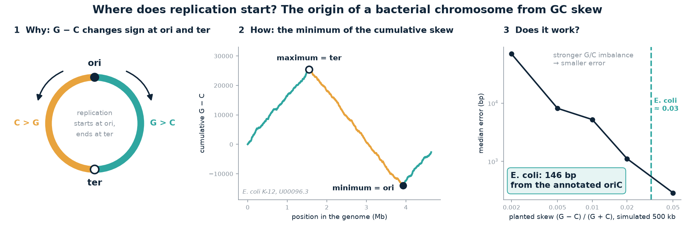

# Demo: the replication origin from GC skew

A small demo repository for the MPA-PRG semester projects 2026. It is **not** one of the project topics: it only shows how a project repository can be organised, tested and run. The method is deliberately simple: the origin of replication of a bacterial chromosome is estimated as the minimum of the cumulative GC skew.



| Member | GitHub account |
|---|---|
| A | `member-a` |
| B | `member-b` |
| C | `member-c` |

## How to run

This section reproduces **every figure and table of the project** from a fresh clone. To run only the method on your own FASTA file, see [Run the core](#run-the-core).

You need [uv](https://docs.astral.sh/uv/) and an internet connection (for the download). Run the commands in the folder of the repository:

1. Install the environment:

   ```
   uv sync
   ```

   uv downloads a suitable Python if needed, creates `.venv/` and installs exactly the versions recorded in `uv.lock`.

2. Reproduce all results:

   ```
   uv run python run_all.py
   ```

   This one command runs three steps and prints the time of each:

   | Step | What it does | Writes | Time |
   |---|---|---|---|
   | Download | downloads U00096.3 from ENA into `data/` and checks its MD5; skipped if a correct copy is already there | `data/U00096.3.fasta` | a few seconds (4.7 MB) |
   | Validation | simulates 5 skews × 30 genomes of 500 kb with a known origin, runs the core on each and measures the error | `results/validation.tsv`, `results/validation.png` | about 15 s |
   | Real genome | runs the core on *E. coli* and compares the estimate with the annotated oriC | `results/real_data.tsv`, `results/skew_U00096.3.png` | under 1 s |

   Approximate times of a single run on a desktop PC (Intel Core Ultra 7 265, 32 GB RAM). The files in `results/` are in git, so `git status` shows whether a run changed any of them. With the same seed the tables stay the same; the figures may differ in a few bytes on another operating system.

3. Optionally, run the tests:

   ```
   uv run pytest
   ```

## Run the core

The core alone, on any FASTA file, for example a genome of your own or one made by `simulate.py` (below). It downloads nothing, runs no experiments and writes only the file given by `-o`. Both tools print their options with `--help`.

### `find_origin.py`: the origin and terminus of every chromosome

```
usage: find_origin.py [-h] -o TSV FASTA
```

Example:

```
uv run python find_origin.py genome.fasta -o result.tsv
```

- **Input:** a FASTA file; every record is one circular chromosome. Lower-case bases are counted as upper-case; other characters (N) are ignored.
- **Output:** a TSV file with a header and one row per record: `record length ori ter`. `ori` and `ter` are 1-based positions on the forward strand of the input: the first base after the minimum (`ori`) and after the maximum (`ter`) of the cumulative skew.

Both arguments are required; the method itself has no parameters. The input is a positional argument (given without a name) and the output an option (`-o`). Their order on the command line does not matter: `-o result.tsv genome.fasta` works as well.

### `simulate.py`: a test genome with a known origin

```
usage: simulate.py [-h] [--length LENGTH] [--ori ORI] [--skew SKEW] [--gc GC]
                   [--seed SEED] -o FASTA
```

Example, a genome and the core run on it:

```
uv run python simulate.py --length 100000 --skew 0.02 --seed 1 -o sim.fasta
uv run python find_origin.py sim.fasta -o result.tsv
```

- **Input:** none; everything is given by the options.
- **Output:** a FASTA file with one record, 80 bases per line. Its header holds the truth, to compare with `ori` and `ter` in `result.tsv`:

  ```
  >simulated ori=47319 ter=97319 skew=0.02 seed=1
  ```

  Both positions are 1-based; the terminus lies half a genome after the origin. From the origin to the terminus G is more frequent than C, on the other half C is more frequent than G.

Options:

- `--length LENGTH`: genome length in bases (default: 100000)
- `--ori ORI`: 1-based position of the origin (default: random, drawn with the seed)
- `--skew SKEW`: strength of the skew, (G − C) / (G + C) on the G-rich half (default: 0.02)
- `--gc GC`: GC content, between 0 and 1 (default: 0.5)
- `--seed SEED`: random seed; the same seed and options give the same genome (default: 1)
- `-o FASTA`, `--output FASTA`: output FASTA file (required)

## Data

| Accession | Organism | Source | File |
|---|---|---|---|
| U00096.3 | *Escherichia coli* K-12 MG1655, complete genome (4.64 Mb) | ENA | `data/U00096.3.fasta` |

## Established tools

| Tool | Version | Settings | Where it ran | Outputs in the repository |
|---|---|---|---|---|
| ENA annotation of oriC in U00096.3 (no tool run) | U00096.3 | feature `rep_origin`, note `oriC` | ENA browser API, EMBL format, 2026-11-12 | `reference/oriC_annotation.tsv` |

## Repository layout

```
project-demo/
├── data/                     # downloaded data, not in git
├── reference/
│   └── oriC_annotation.tsv   # annotated oriC used for the comparison
├── results/                  # figures and tables, generated by run_all.py
├── tests/                    # pytest
│   ├── test_cli.py           #   the command line end to end
│   ├── test_simulate.py      #   simulator, planted origin is found
│   └── test_skew.py          #   toy data, invariants, brute force, edge cases
├── .gitignore                # keeps data/ and .venv/ out of git
├── download_data.py          # downloads the genome from ENA by accession, checks its MD5
├── experiments.py            # validation experiment, real-genome analysis, figures
├── find_origin.py            # command line for the core (see "Run the core")
├── graphical_abstract.png    # the figure at the top of this README
├── plan.md                   # example of a CP1 plan
├── pyproject.toml
├── run_all.py                # one command for all results
├── simulate.py               # simulator of genomes with a planted origin (also a command-line tool)
├── skew.py                   # the core: cumulative skew, origin estimate, circular distance
└── uv.lock
```

## Code from the labs

None.
